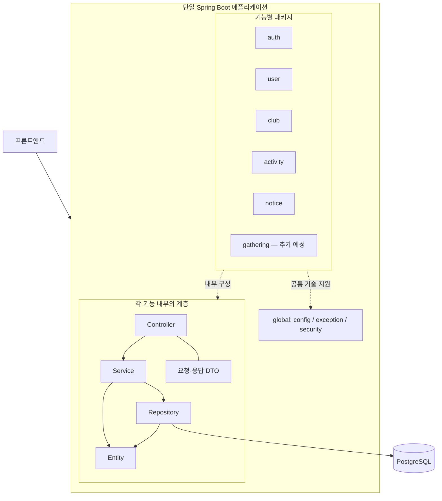
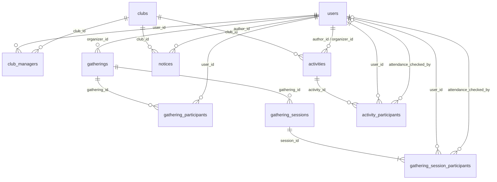

# 42 Clubs Backend

42 교육생을 위한 동아리 정보 탐색 및 운영 관리 플랫폼의 백엔드입니다.

## 기술 스택

기술 선정과 실제 코드 반영 여부를 구분합니다. 도입 예정 항목은 해당 설계 단계에서 설정합니다.

| 영역 | 기술 및 방향 | 결정 상태 | 반영 상태 |
| --- | --- | --- | --- |
| Language | Java 17 | 확정 | 적용 완료 |
| Framework | Spring Boot 3.5.x | 확정 | 적용 완료 |
| Build | Gradle Wrapper | 확정 | 적용 완료 |
| Formatting | Spotless / Google Java Format (AOSP) | 채택 | 적용 완료 |
| 반복 코드 생성 | Lombok | 채택 | 메인·테스트 annotation processor 설정, User·Club 및 서비스·Controller 적용 |
| Web | Spring Web MVC | 확정 | 적용 완료 |
| Security | Spring Security | 채택 | 인증·인가 설계 후 도입 |
| ORM | Spring Data JPA / Hibernate | 채택 | 적용 완료, User·Club 매핑 도입 |
| Database | PostgreSQL 17.6 | 채택 | 로컬 Compose·테스트 컨테이너 구성 |
| Validation | Jakarta Bean Validation | 확정 | Starter 적용 완료 |
| API Documentation | springdoc-openapi 2.8.x / Swagger UI | 채택, 패치 버전 미정 | API 구현 시 도입 |
| DB Migration | Flyway | 채택 | 적용 완료, users·clubs 마이그레이션 |
| Test | JUnit 5 / Mockito | 확정 | Starter 적용 완료 |
| 개발용 DB 환경 | Docker Compose로 PostgreSQL 실행 | 채택 | 적용 완료 |
| 애플리케이션 컨테이너화 | Docker | 검토 중 | 배포 환경 결정 후 검토 |
| 로그인 제공자 | 42 인증 후 최초 로그인 시 계정 생성, 일반 회원가입 없음 | 설계 기준 확정 | 실제 연동 가능 여부 확인 및 구현 필요 |
| 로그인 상태 유지 | 서버 세션 우선 검토, 토큰 방식과 비교 | 미정 | 프론트엔드·백엔드 도메인 구성 확인 후 결정 |
| CI | GitHub Actions에서 PR 빌드·테스트 | 채택 | 워크플로 도입 예정 |
| CD | 배포 대상과 자동 배포 방식 | 미정 | 실제 배포 범위 결정 후 설계 |

정확한 버전은 [build.gradle](build.gradle)과 [Gradle Wrapper 설정](gradle/wrapper/gradle-wrapper.properties)에서 관리합니다.
Spring Boot가 관리하는 라이브러리 버전은 Boot의 의존성 관리에 맡깁니다.
springdoc-openapi는 [공식 호환표](https://springdoc.org/v2/)에 따라 Boot 3.5.x와 호환되는 2.8.x에서 패치 버전을 고정합니다.

## 개발 환경 및 실행

Java 17 JDK를 설치하고 IDE에서 이 폴더를 Gradle 프로젝트로 열어 주세요.
Gradle JVM도 Java 17로 설정합니다. 최초 빌드에는 의존성 다운로드를 위한 인터넷 연결이 필요합니다.
Lombok은 컴파일 시 getter·생성자 등의 코드를 생성하며 런타임 의존성으로 포함하지 않습니다.
버전은 Spring Boot BOM으로 관리합니다. IDE에서 Lombok 생성 코드를 인식하지 못하면 Gradle 프로젝트를 새로고침하고
annotation processing 설정 및 IDE의 Lombok 지원을 확인합니다.

```sh
docker compose up -d --wait
./gradlew bootRun
```

Docker Desktop 또는 Docker Engine과 Compose가 필요합니다. DB는 로컬 주소 `127.0.0.1:5432`에서만 접근할 수 있습니다.
기본 로컬 DB 이름·사용자·비밀번호는 `clubs` / `clubs` / `clubs_local`이며 개발 환경 전용입니다.
애플리케이션 시작 시 Flyway가 마이그레이션을 적용하고 Hibernate가 매핑을 검증합니다.
DB 데이터는 Compose의 볼륨에 유지됩니다. `docker compose stop`으로 DB를 중지할 수 있습니다.

환경 변수 항목은 [.env.example](.env.example)을 참고합니다.
기본값을 사용하면 별도 환경 파일 없이 실행할 수 있습니다.
Compose는 `.env`를 자동으로 읽지만 Spring Boot는 읽지 않으므로, 값을 변경하면 셸 또는 IDE 실행 설정에도
`DB_URL`, `DB_USERNAME`, `DB_PASSWORD`를 설정해야 합니다.
포트를 변경하면 `POSTGRES_PORT`와 `DB_URL`의 포트를 함께 변경합니다.
기존 볼륨의 DB 이름·사용자·비밀번호는 환경 변수 변경만으로 다시 초기화되지 않습니다.
배포 환경에서는 DB 접속 값을 명시적으로 설정합니다.

```sh
./gradlew build
```

테스트는 Testcontainers가 별도 PostgreSQL 컨테이너를 생성하므로 Docker가 실행 중이어야 합니다.
로컬 Compose DB를 먼저 실행할 필요는 없으며 개발 DB의 데이터를 사용하지 않습니다.
Docker가 없으면 DB 통합 테스트가 실패합니다. 자동으로 생략하지 않습니다.
Windows에서는 `gradlew.bat build`, `gradlew.bat bootRun`을 사용합니다.
애플리케이션은 기본 포트 `8080`으로 실행됩니다. 동아리 공개 목록·상세 API를 제공합니다.
요청·응답 계약은 [동아리 조회 명세](docs/api-endpoints.md#동아리-공개-조회--구현-계약)를 참고합니다.
새 DB에는 초기 동아리 데이터가 없어 목록이 비어 있습니다. `/`에는 엔드포인트가 없어 404 응답이 정상입니다.

```sh
curl 'http://localhost:8080/api/v1/clubs?page=0&size=20'
```

## 코드 포맷팅

[Spotless](https://github.com/diffplug/spotless/tree/main/plugin-gradle)를 통해 Java 소스와 테스트의 포맷을 통일합니다.
포맷터 버전은 `build.gradle`에 고정하며,
기존 EditorConfig와 맞춰 들여쓰기 4칸을 사용하는 AOSP 스타일을 적용합니다.
미사용 import 제거, 줄 끝 공백 제거 및 파일 마지막 개행도 적용합니다.

```sh
# 포맷 검사
./gradlew spotlessCheck

# 자동 수정
./gradlew spotlessApply
```

`./gradlew build`와 `./gradlew check`에도 포맷 검사가 포함됩니다.
포맷이 맞지 않으면 빌드가 실패하므로 `spotlessApply`로 수정한 뒤 변경 내용을 확인합니다.
빌드 중에는 파일을 자동 수정하지 않습니다.
IntelliJ에서는 Gradle 프로젝트를 새로고침한 뒤 Gradle 도구 창에서 동일한 태스크를 실행할 수 있습니다.
IDE 자체 포맷터와 결과가 다를 경우 Spotless 설정을 기준으로 합니다.

## 아키텍처

Modular Monolith + Package by Feature + Layered Architecture를 적용합니다.
아래는 목표 구조이며, DB 기반·User·Club 매핑과 동아리 공개 조회를 구현했습니다.
인증·쓰기 API·활동·공지·소모임 기능은 아직 구현 전입니다.



패키지별 책임·의존성 및 영속성·테스트 규칙은 [아키텍처 문서](docs/architecture.md)에서 관리합니다.
호출 흐름 예시와 구현·리뷰 시 주의 사항은 [기능 모듈 구현 가이드](docs/module-development.md)를 참고합니다.

## ERD

아래는 10개 테이블의 **관계도 원본**입니다. 역할이 다른 FK는 간선 설명으로 구분합니다.
`activities`의 작성자와 주최자는 각각 독립된 필수 사용자 관계입니다.
소모임 반복 규칙과 고정 멤버 모집 등 일부 컬럼은 상세 설계가 남아 있습니다.
[동아리 가입 한도 정책](docs/domain-model.md#동아리-가입-한도--확정)에 필요한 회원 가입 관계는 추가 설계 대상이며 현재 관계도에 포함되지 않았습니다.



컬럼·타입·제약조건·인덱스는 [ERD 상세 명세](docs/erd.md)를 참조합니다.

## 도메인 및 API

- [도메인 관계와 업무 규칙](docs/domain-model.md): 정책 결정과 미정 사항
- [API 엔드포인트 및 구현 계약](docs/api-endpoints.md): 동아리 공개 조회 계약 및 나머지 API 초안

## 문서 관리 (SSOT)

동일한 규칙은 아래 지정된 한 곳에서 관리합니다. 다른 문서에서는 규칙을 복사하지 않고 해당 문서를 링크합니다.

| 정보 | 기준 위치 |
| --- | --- |
| 실행·포맷 명령, 기술 선정 현황, 브랜치 전략, 개발 진행 상태 | README |
| 아키텍처·ERD 다이어그램 | README |
| 실제 의존성 버전·포맷 설정 | build.gradle, gradle/wrapper/gradle-wrapper.properties |
| 패키지 책임, 계층·의존성, DB 운영·테스트 원칙 | docs/architecture.md |
| 모듈 구현 흐름 예시, 규칙 적용 방법·리뷰 질문 | docs/module-development.md |
| 업무 규칙·상태 전이·정책상 미정 사항 | docs/domain-model.md |
| 물리 컬럼·타입·PK/FK·제약조건·인덱스 | docs/erd.md |
| HTTP 메서드·경로·API 권한·계약 | docs/api-endpoints.md |

기능 변경은 **도메인 → ERD → API → 마이그레이션·코드·테스트** 순서로 진행합니다.
스키마 영향이 없으면 ERD 검토 결과 변경 불필요로 판단하고 진행합니다.
관계가 바뀌면 README 관계도를, 컬럼이 바뀌면 ERD 명세를 갱신하며 같은 내용을 양쪽에 복제하지 않습니다.
미정 정책은 도메인 문서에서 관리하고 다른 문서의 영향 구간에는 링크를 둡니다.
문서와 구현이 다르면 실제 반영 여부를 확인해 같은 PR에서 정정합니다.
공유 DB에 적용된 스키마 변경 이력의 원본은 향후 추가할 Flyway 마이그레이션입니다.

## 도입 순서

1. 기본 프로젝트 및 기능별 패키지 구성 — 완료
2. 도메인 모델링 및 ERD 설계 — MVP 10개 테이블 관계·핵심 키 확정, 소모임 후속 컬럼·정책과 동아리 가입 관계 확장은 문서에서 관리
3. JPA, PostgreSQL, Flyway와 개발용 Docker Compose 도입 — 완료, users·clubs 구현 및 기능별 마이그레이션 추가 예정
4. 인증·인가 설계 및 Spring Security 적용
5. API 설계 결과에 따른 패키지 조정, API 구현 및 springdoc-openapi 도입 — 동아리 공개 조회부터 구현, 인증·쓰기 API·springdoc은 후속

CI는 위 단계와 별개로 먼저 구성할 수 있습니다.

## 현재 구현 범위

프로젝트 실행 설정, 패키지 골격, PostgreSQL·JPA·Flyway 기반을 제공합니다.
users·clubs 테이블과 User·Club 엔티티, 동아리 공개 목록·상세 조회를 구현했습니다.
목록은 페이지네이션과 운영 상태 필터를 제공하며 상세에는 기본 정보와 모집 안내를 반환합니다.
운영 상태는 활성(`ACTIVE`)과 아카이브(`ARCHIVED`) 두 가지이며 휴면 상태는 두지 않습니다.
PostgreSQL 통합 테스트로 마이그레이션·매핑·저장/조회·DB 제약·페이지네이션·모집 날짜 경계·400/404 응답을 검증합니다.
인증 제공자, Spring Security, 쓰기 API와 나머지 도메인 기능은 아직 도입하지 않았습니다.
동아리 활동도는 활동 도메인과 집계 경계 구현 후 추가합니다.
관리 API를 구현할 때는 인증과 동아리별 접근 권한 검증을 함께 적용해야 합니다.

## 브랜치 전략

현재 백엔드는 1인 개발로 진행하며 `main`·`develop`을 유지합니다.
일반적인 기능·정책 변경은 최신 `develop`에서 작업하고 검증 후 직접 커밋·push합니다.
기능마다 별도 브랜치나 PR, 다른 개발자의 리뷰를 필수로 요구하지 않습니다.
변경 격리나 검토가 필요할 때만 작업 브랜치·PR을 사용하며 worktree도 필요할 때만 사용합니다.
자동 개발 작업에도 같은 흐름을 적용하며 [AGENTS.md](AGENTS.md)에 협업 규칙을 기록합니다.

| 브랜치 | 목적 | 반영 방식 |
| --- | --- | --- |
| main | 검증된 릴리스 기준. 현재는 기존 초기 상태 유지 | 별도 릴리스 요청 시 develop → main |
| develop | 다음 릴리스를 위한 개발 통합 및 기본 작업 브랜치 | 검증한 변경을 직접 커밋·push |
| feature/<이슈번호>-<설명> | 선택적인 기능 작업 격리 | develop에서 분기, develop으로 반영 |
| fix/<이슈번호>-<설명> | 선택적인 버그 수정 격리 | develop에서 분기, develop으로 반영 |
| docs/<설명> | 선택적인 문서·설계 작업 격리 | develop에서 분기, develop으로 반영 |
| chore/<설명> | 선택적인 빌드·도구·환경 작업 격리 | develop에서 분기, develop으로 반영 |

이슈가 없으면 번호를 생략합니다. 예: `feature/gathering-sessions`, `docs/api-endpoints`.

1. 작업 시작 전 `develop`을 최신화합니다. 변경 격리가 필요하면 작업 브랜치를 만듭니다.
2. 기능·정책 단위로 커밋합니다. 설계 변경은 관련 기준 문서를 함께 수정합니다.
3. 코드 변경은 `./gradlew build`로 검사합니다. 문서만 바뀌면 링크·다이어그램·문서 일관성을 확인합니다.
4. 검증한 변경을 `develop`에 push합니다. PR을 사용하면 변경 후 동작·검증 결과·DB 마이그레이션·문서 영향을 기록하며, 기존 PR 병합은 별도 요청이 있을 때 진행합니다.
5. `main` 반영과 릴리스는 별도 요청이 있을 때 진행합니다. 릴리스 시 develop → main은 일반 merge로 이력을 연결하고 태그를 남깁니다.

향후 배포 후 긴급 수정이 필요하면 main에서 `hotfix/<설명>`을 만들어 수정하고,
main을 develop에도 병합하여 수정이 누락되지 않도록 합니다. 별도 release 브랜치는 현재 두지 않습니다.
GitHub 브랜치 보호와 CI는 아직 설정하지 않았습니다.
