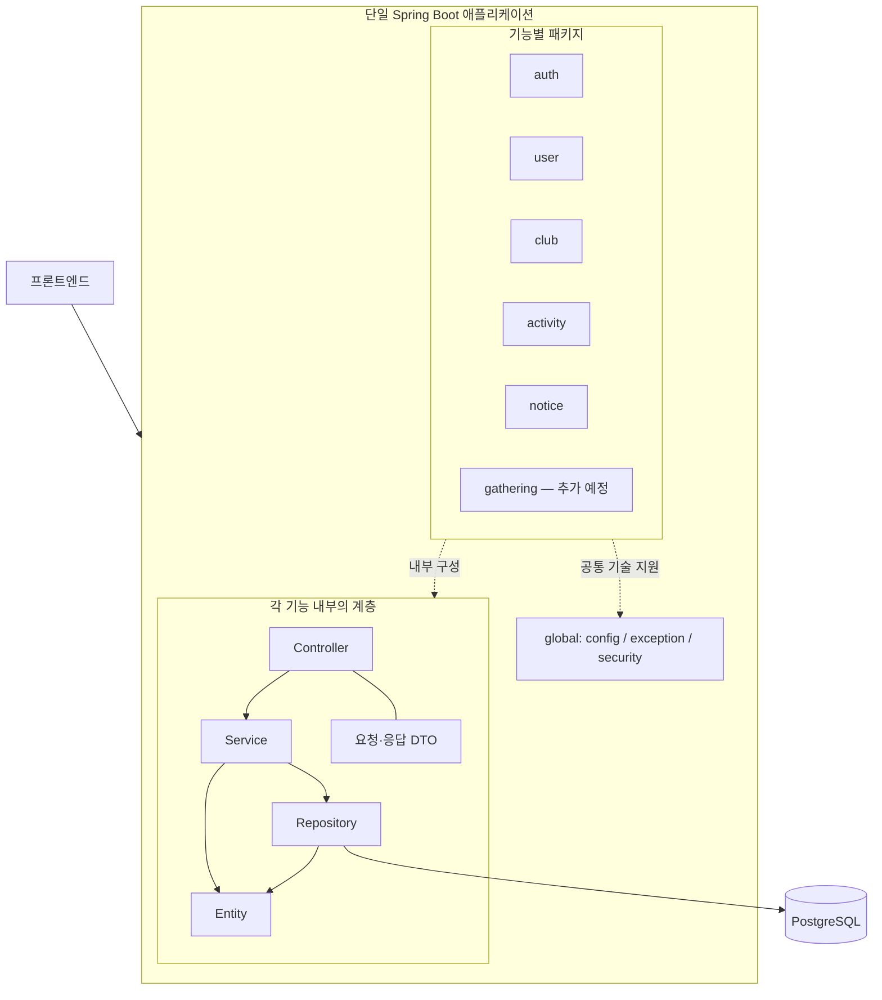

# 백엔드 아키텍처

## 결정

Java 17과 Spring Boot 3.5 기반의 단일 애플리케이션을 구성합니다.
Modular Monolith를 지향하며, 기능별 패키지와 내부 Layered Architecture를 적용합니다.
MVP에서는 단일 Gradle 모듈로 시작합니다. 모듈 경계는 코드 리뷰와 아래 의존성 규칙으로 관리하며,
현재 빌드 설정이 패키지 간 접근을 강제로 제한하지는 않습니다.

실제 구현 현황은 [README](../README.md#현재-상태)를 참고합니다.
실제 라이브러리 버전은 [build.gradle](../build.gradle)과 [Wrapper 설정](../gradle/wrapper/gradle-wrapper.properties)이 기준입니다.

호출 흐름 예시와 구현·리뷰 시 주의 사항은 [기능 모듈 구현 가이드](module-development.md)를 참고합니다.

## 구조

## 기능 경계

| 패키지 | 책임 |
| --- | --- |
| auth | 42 OAuth·세션 인증 설정, 경산 자격 검사·로그인 유스케이스 |
| user | 교육생 계정과 사용자 정보 |
| club | 동아리 기본 정보, 운영 상태, 모집 정보, 동아리 관리 권한 |
| activity | 동아리 활동·사진·선착순 참가·취소 |
| gathering (추가 예정) | 독립된 소모임 글·개최 회차·선착순 참가·취소 |
| notice | 동아리별 공지사항 |
| global | 기술 공통 설정, 예외 처리, 보안 인프라 |

ClubManager는 별도 최상위 기능으로 만들지 않고 우선 club의 책임으로 봅니다.
논의한 관계와 업무 규칙은 [도메인 관계 문서](domain-model.md)에 기록합니다.
구현된 스키마와 설계 초안은 [ERD](erd.md)를 기준으로 하며, JPA 매핑은 구현 단계에서 구체화합니다.
동아리 입부 모집은 축소 MVP에서 제외하며 기존 Club 모집 스키마·공개 응답은 유지합니다.
활동 참가 모집은 activity, 소모임 참가 모집은 gathering에서 관리합니다. 핵심 구현 범위는 [축소 MVP](domain-model.md#축소-mvp--2026-10-14-확정)를 따릅니다.

## 계층별 책임

| 계층 | 책임 |
| --- | --- |
| controller | 요청 형식 검증, HTTP 요청·응답 처리, 서비스 호출 |
| service | 유스케이스 실행, 리소스별 권한 검증, 트랜잭션 경계 |
| repository | 영속성 접근 |
| entity | 상태 및 상태 변경 규칙 |
| dto | API 요청·응답 데이터 |

Controller는 Repository를 직접 호출하지 않습니다. 엔티티를 API 응답으로 직접 노출하지 않습니다.
서비스 인터페이스와 구현체는 필요성이 생겼을 때 분리합니다.
현재는 도메인 모델과 영속성 모델을 별도로 나누지 않습니다.

### Lombok 사용

Lombok은 getter와 기본 생성자 등 반복 코드에 사용할 수 있습니다.
메인·테스트 소스 모두 컴파일 전용 의존성과 annotation processor를 설정하며 버전은 Spring Boot BOM을 따릅니다.
입력 검증이나 기본 역할 지정처럼 업무 규칙이 있는 생성자는 직접 작성합니다.
JPA 엔티티의 기본 생성자는 `protected`로 유지하며 Lombok을 사용하면 `@NoArgsConstructor(access = AccessLevel.PROTECTED)`로 표현합니다.
엔티티에 `@Data`, 클래스 전체 `@Setter`, 전체 필드 공개 생성자를 일괄 적용하지 않습니다.
상태 변경은 의미 있는 메서드로 제공하고, `equals`·`hashCode`·`toString`은 식별자와 연관관계를 고려해 설계합니다.

## 기능 간 의존성

- 다른 기능의 Repository에 직접 접근하지 않습니다.
- 기능 간 협력이 필요하면 소유 기능의 명시적인 서비스 메서드를 호출합니다.
- 다른 기능의 내부 엔티티 노출을 줄이고 식별자나 필요한 조회 결과로 협력합니다.
- 상호 호출로 순환 의존성을 만들지 않습니다. 발생하면 책임과 호출 흐름을 재검토합니다.
- global은 개별 기능에 의존하지 않습니다. 동아리 권한 같은 업무 규칙은 소유 기능에 둡니다.

예를 들어 활동 등록 서비스는 club이 제공하는 관리 권한 검증 기능을 호출한 뒤 활동을 저장합니다.
club이 활동 등록 서비스를 다시 호출하는 구조는 피합니다.
보안 인프라의 역할 검사와 특정 동아리에 대한 관리 권한 검증은 별도로 수행합니다.

## 구현 및 검증 방향

현재는 1인 개발로 기능 단위로 구현하고 검증합니다. 업무 정책은 [도메인 문서](domain-model.md),
컬럼과 제약조건은 [ERD 명세](erd.md), 경로와 요청별 권한은 [API 초안](api-endpoints.md)을 참조합니다.
변경 순서와 협업 규칙은 [README](../README.md#문서-관리-ssot)에서 관리합니다.

### 데이터베이스

- Flyway가 스키마 변경을 담당하고, JPA/Hibernate는 엔티티 매핑과 데이터 접근을 담당합니다.
- Hibernate의 `ddl-auto`는 `validate`를 사용합니다.
- 마이그레이션 SQL은 `src/main/resources/db/migration`에서 관리합니다.
- 공유 환경에 적용된 마이그레이션은 수정하지 않고 새 버전 파일을 추가합니다.
- PostgreSQL 연동 시 Flyway의 `flyway-database-postgresql` 모듈을 함께 사용합니다.
- 개발 중에는 IDE에서 애플리케이션을 실행하고, Docker Compose로 로컬 PostgreSQL을 실행합니다.
- 로컬 DB와 테스트 DB는 PostgreSQL 17.6을 사용합니다. 실행과 환경 변수 설정은 [README](../README.md#개발-환경-및-실행)를 따릅니다.

### 테스트 및 CI

- JUnit 5와 Mockito는 `spring-boot-starter-test`가 제공하는 의존성을 사용합니다.
- 도메인 규칙과 서비스 로직을 테스트하고, DB 제약조건·쿼리는 PostgreSQL 통합 테스트로 검증합니다.
- DB 통합 테스트는 Testcontainers와 Spring Boot의 `@ServiceConnection`으로 별도 PostgreSQL을 사용합니다.
  Docker가 실행 중이어야 하며 사용할 수 없으면 테스트를 생략하지 않고 실패합니다.
- 우선 검증할 사례는 타 동아리 수정 거부, 활동·공지의 소속 동아리 권한, 모집 기간 유효성, 관리 권한 중복입니다.
- 동아리 공개 조회는 MockMvc와 PostgreSQL을 연결해 필터·페이지네이션·모집 날짜 경계·400/404를 검증합니다.
- CI 도입 시 PR마다 `./gradlew build`를 실행합니다. CD는 배포 환경을 결정한 뒤 구성합니다.
