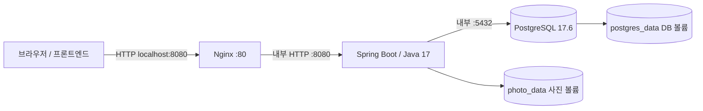

# Docker Compose 실행

## 구성



기본 [compose.yaml](../compose.yaml)은 세 서비스를 실행합니다. 외부 포트는 Nginx만 열며 백엔드·DB는 서비스 이름으로 내부 통신합니다. Nginx는 API·OAuth 시작/콜백·로그아웃·사진 경로를 원래 URI 그대로 전달합니다. 사진 폴더를 직접 공개하지 않고 백엔드의 DB 연결·삭제 여부 검사를 유지합니다. 프론트엔드와 TLS 인증서 발급·HTTPS 설정은 이 구성에 포함하지 않습니다.

## 실행

Docker Engine/Desktop과 Compose가 필요합니다. 호스트 JDK는 컨테이너 실행에는 필요하지 않습니다.

```sh
docker compose up -d --build --wait
curl 'http://localhost:8080/api/v1/clubs?page=0&size=20'
docker compose ps
```

새 DB의 동아리 목록은 비어 있습니다. 초기 정보는 [초기 데이터 절차](initial-data-setup.md)에 따라 입력합니다. 기본 AUTH_ENABLED=false이므로 실제 등록·로그인은 [인증 환경변수](environment-variables.md#인증)를 설정해야 합니다. 인증 우회 계정은 추가하지 않습니다.

설정이 필요하면 `.env.example`을 참고해 프로젝트 `.env`를 작성합니다. 기존 `.env`가 있으면 필요한 항목만 추가합니다. Compose가 지정한 인증 환경변수를 백엔드 컨테이너에 전달합니다. 로그인 디버그 프로필은 Compose에서 전달하지 않습니다.

이미지 빌드는 Gradle Wrapper로 bootJar를 생성한 뒤 Java 17 JRE 이미지에 복사합니다. 런타임은 UID/GID 10001로 실행합니다. Docker 빌드는 JUnit/Testcontainers를 실행하지 않으므로 코드 검증은 별도로 `./gradlew build`를 실행합니다. 최초 빌드는 베이스 이미지·패키지·Gradle 의존성 다운로드에 인터넷이 필요합니다. `.env`·로컬 사진·Git 이력은 빌드 컨텍스트에서 제외합니다.

DB healthcheck 성공 후 백엔드가 시작되고, Flyway·애플리케이션 준비가 끝나 공개 목록 API가 성공한 뒤 Nginx가 시작됩니다. 백엔드 재생성 시 Nginx가 Docker DNS를 다시 조회합니다. Nginx 업로드 한도는 백엔드와 같은 27MiB입니다. 쿠키·CSRF 정책을 유지하고 외부에서 주입한 전달 헤더는 Nginx 값으로 교체합니다. [Nginx 프록시 문서](https://nginx.org/en/docs/http/ngx_http_proxy_module.html), [Compose 시작 순서](https://docs.docker.com/compose/how-tos/startup-order/)를 참고합니다.

## 사진과 DB 보존

- 사진: `photo_data` 볼륨 → 백엔드 `/app/data/photos`에 마운트합니다. 호스트의 `./data/photos`와는 별개입니다.
- DB: 기존 `postgres_data` 볼륨을 유지합니다. 같은 Compose 프로젝트 이름이면 기존 DB 볼륨을 재사용합니다.
- 사진 URL: 기본 `http://localhost:8080/api/v1/photos/activities/{filename}`입니다. 프론트는 응답 URL을 그대로 사용합니다.
- `docker compose stop`과 `docker compose down`은 볼륨을 보존합니다. `down -v`는 DB와 사진 볼륨을 삭제하므로 초기화가 필요할 때만 실행합니다.
- 백엔드 재시작 후 DB·사진은 유지되지만 메모리 세션은 사라져 다시 로그인해야 합니다.

기존 호스트 사진을 옮길 때 백엔드를 먼저 중지하고 `storage_key`와 같은 상대 경로로 복사합니다.

```sh
docker compose stop backend nginx
docker compose create backend
container_id=$(docker compose ps -a -q backend)
docker cp ./data/photos/. "$container_id":/app/data/photos/
docker compose run --rm --no-deps --user root --entrypoint chown backend -R 10001:10001 /app/data/photos
docker compose up -d --wait
```

DB의 사진 경로와 사진 파일을 함께 보관해야 복원 후 조회할 수 있습니다. S3 사진도 같은 경로로 복사해야 하며 저장소 전환 전에 기존 저널 정리를 완료합니다.

## 주소 변경·홈서버 접속

기본은 로컬 PC에서만 접근하도록 `127.0.0.1:8080`에 바인딩합니다. 홈서버·LAN에서 접근할 때 `.env`에 실제 서버 주소를 지정합니다.

```dotenv
HTTP_BIND_ADDRESS=0.0.0.0
HTTP_PORT=8080
PHOTO_LOCAL_BASE_URL=http://서버주소:8080
FT_REDIRECT_URI=http://서버주소:8080/login/oauth2/code/42
```

`PHOTO_LOCAL_BASE_URL`·`FT_REDIRECT_URI`는 컨테이너 내부 주소가 아닌 브라우저가 접근하는 Nginx 주소입니다. 포트를 바꾸면 두 URL도 맞춥니다. AUTH_SUCCESS_URL·AUTH_ALLOWED_ORIGINS는 실제 프론트엔드 주소로 맞추고 42 앱에도 동일한 콜백을 등록합니다. 현재 Nginx는 HTTP를 종료하므로 HTTP 환경의 AUTH_COOKIE_SECURE는 false입니다. HTTPS 종료 프록시를 추가할 때는 전달 스킴과 쿠키 설정을 함께 조정합니다.

## IDE에서 백엔드 실행

DB만 Compose로 실행하는 방식도 유지합니다. 기본 구성과 [개발용 설정](../compose.dev.yaml)을 함께 사용해 PostgreSQL만 시작합니다.

```sh
docker compose -f compose.yaml -f compose.dev.yaml up -d --wait postgres
./gradlew bootRun
```

전체 구성과 호스트 백엔드를 동시에 8080에서 실행하면 포트가 충돌합니다. 전체 구성의 nginx·backend를 먼저 중지합니다. 호스트 DB 포트는 POSTGRES_PORT, 호스트 애플리케이션 연결은 DB_URL로 지정합니다. 전체 Compose의 DB_URL은 `postgres:5432`로 고정 조합하므로 호스트용 DB_URL을 사용하지 않습니다.

## 확인·재시작

```sh
docker compose logs --tail=100 nginx backend postgres
docker compose exec nginx nginx -t
docker compose restart backend
docker compose up -d --build --wait
docker compose down
```

환경변수 변경은 `up -d --wait`로 컨테이너를 재생성해야 반영됩니다. 소스 변경은 `--build`로 다시 빌드합니다. 로그·Compose 출력에는 환경 정보가 포함될 수 있으므로 실제 비밀값을 공유 문서에 붙이지 않습니다.

## 검증 기록

2026-10-16 기준 `./gradlew build --offline`와 실제 Docker 이미지 빌드가 통과했습니다. 별도 Compose 프로젝트·테스트 볼륨에서 세 서비스 healthcheck, Nginx 구문, API·쿠키·CSRF 전달, 2MiB 요청 전달·28MiB 요청 차단, 비루트 사진 쓰기, 미연결 사진 404·연결 사진 조회·응답 URL을 확인했습니다. 전체 컨테이너를 재생성한 뒤에도 DB와 사진이 유지되고 Nginx만 호스트 포트를 공개함을 확인했습니다. 실제 42 OAuth 인증과 HTTPS는 이 검증에 포함하지 않습니다.
