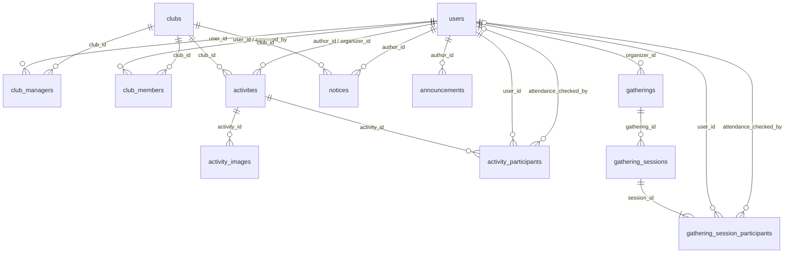

# 데이터 모델과 ERD

실제 DB에는 `users`([V1](../src/main/resources/db/migration/V1__create_users.sql))와 `clubs`([V2](../src/main/resources/db/migration/V2__create_clubs.sql)), `club_managers`([V3](../src/main/resources/db/migration/V3__add_super_admin_and_club_managers.sql))가 있습니다. V3는 users.role CHECK에도 SUPER_ADMIN을 추가합니다.
V4에 club_members, V5에 notices, V6에 activities·activity_images·activity_participants·image_uploads, V7에 gatherings·gathering_sessions·gathering_session_participants, V8에 notices.visibility, V9에 announcements를 구현했습니다. 부원·기본 출결은 아래 MVP 설계에 포함하고 참가 승인제·고정 멤버는 [후속 스키마](future-design.md#후속-스키마)에 분리합니다.

- [관계도](#관계도) · [공통 규칙](#공통-규칙)
- 구현됨: [users](#users) · [clubs](#clubs) · [관리 권한](#club_managers)
- 구현됨: [부원](#club_members) · [활동](#activities) · [동아리 공지](#notices) · [운영 공지](#announcements) · [소모임](#gatherings) · [회차](#gathering_sessions) · [회차 참가](#gathering_session_participants) · [활동 참가](#activity_participants) · [사진](#activity_images)
- [인덱스](#초기-인덱스) · [잠금·정리 정책](#구현된-잠금정리-정책)

## 관계도

아래 관계는 V1~V9에 구현되어 있습니다. 아래 도식에는 부원·기본 출결을 포함하며 고정 멤버 관계는 후속 설계입니다.

## 공통 규칙

- PK는 자동 생성 BIGINT, 필수 FK는 NOT NULL이며 users 등 내부 PK를 참조합니다. 표의 필수 O는 NOT NULL입니다.
- 생성·수정·개최·활동 및 소모임 모집 마감은 TIMESTAMPTZ입니다. 기존 Club 입부 모집 날짜는 DATE로 유지합니다.
- 역할·상태는 VARCHAR와 CHECK로 허용값을 제한합니다. 문자열 공백 등 입력 검증은 별도로 적용합니다.
- FK에 연쇄 삭제를 설정하지 않습니다. updated_at은 애플리케이션에서 갱신합니다.
- 활동·공지·소모임의 deleted_at은 NULL이면 미삭제이며 일반 조회에 IS NULL 조건을 적용합니다. 삭제 실행 API는 후속입니다.
- D-Day·현재 인원·잔여 정원·모집 표시 상태는 파생 값이며 저장하지 않습니다.

## users

| 컬럼 | 타입 | 필수 | 제약 및 의미 |
| --- | --- | --- | --- |
| id | BIGINT | O | PK |
| intra_id | BIGINT | O | UNIQUE, 42 계정 연결 기준 |
| intra_login | VARCHAR(100) | O | Intra 로그인명, 계정 연결 기준으로 사용하지 않음 |
| display_name | VARCHAR(100) | O | 표시 이름 |
| role | VARCHAR(20) | O | USER / ADMIN / SUPER_ADMIN, 기본값 USER |
| created_at | TIMESTAMPTZ | O | 계정 생성 시각 |
| updated_at | TIMESTAMPTZ | O | 수정 시각 |

- 위 표는 V1·V3·User 엔티티의 구현 상태입니다. V3가 role CHECK에 SUPER_ADMIN을 추가하며 기존 V1은 유지합니다. account_status·BLACKHOLED 상태·식별 정보의 조건부 NULL 제약은 추가하지 않습니다.
- 현재 내부 id와 UNIQUE intra_id를 분리합니다. 숫자 intra_id는 UNIQUE 계정 연결 키, intra_login은 표시·검색 값으로 유지합니다. 로그인명을 PK로 바꾸지 않습니다.

계정 생성·권한 부여 정책은 [도메인 문서](domain-model.md#사용자-역할과-동아리-관리-권한)를 참조합니다.

## clubs

| 컬럼 | 타입 | 필수 | 제약 및 의미 |
| --- | --- | --- | --- |
| id | BIGINT | O | PK |
| name | VARCHAR(100) | O | 동아리 이름, 현재 UNIQUE 없음 |
| summary | VARCHAR(200) | O | 목록용 짧은 소개 |
| description | TEXT | O | 상세 소개 |
| operation_status | VARCHAR(20) | O | ACTIVE / ARCHIVED |
| recruitment_planned | BOOLEAN | O | 모집 계획 여부, 기본값 false |
| recruitment_start_date | DATE | 조건부 | 모집 계획이 있으면 필수 |
| recruitment_end_date | DATE | X | 없으면 시작일부터 상시 모집 |
| recruitment_closed_early | BOOLEAN | O | 수동·운영 상태 변경에 따른 마감, 기본값 false |
| application_method | TEXT | 조건부 | 모집 계획이 있으면 지원 방법 필수 |
| application_url | VARCHAR(2048) | X | 외부 지원 링크 |
| created_at | TIMESTAMPTZ | O | 생성 시각 |
| updated_at | TIMESTAMPTZ | O | 수정 시각 |

### 모집 정보의 데이터 제약

- 모집 계획이 있으면 시작일과 지원 방법이 필수입니다.
- 종료일이 있으면 시작일도 존재하고 종료일 >= 시작일이어야 합니다.
- recruitment_closed_early가 true이면 recruitment_planned도 true여야 합니다.
- [모집 계획 취소](future-design.md#모집-계획-취소--확정) 시 recruitment_planned와 recruitment_closed_early는 false, recruitment_start_date·recruitment_end_date·application_method·application_url은 NULL로 저장합니다. 이 초기화는 후속 모집 쓰기 유스케이스에서 처리하며, 현재 DB CHECK는 이 NULL 조합 전체를 강제하지 않습니다.

상태 변경과 아카이브·재모집 동작은 [도메인 정책](future-design.md#게시-및-아카이브-정책--확정)을 따릅니다.
활동도·표시용 모집 상태는 파생 값이며 저장 컬럼을 두지 않습니다. 활동도의 날짜 경계와 수정 반영은 [집계 정책](future-design.md#활동도-계산)을 따릅니다. 별도 아카이브 테이블이나 archived_at 컬럼은 없습니다.

## club_managers

V3로 구현되었습니다. 동아리별 조회용 INDEX(club_id)도 적용했습니다. 초기 입력은 [운영 절차](initial-data-setup.md)를 따릅니다.

| 컬럼 | 타입 | 필수 | 제약 및 의미 |
| --- | --- | --- | --- |
| id | BIGINT | O | PK |
| user_id | BIGINT | O | FK → users.id |
| club_id | BIGINT | O | FK → clubs.id |
| created_at | TIMESTAMPTZ | O | 권한 부여 시각 |

- UNIQUE(user_id, club_id)로 관리 권한 중복을 방지합니다.
- 동아리별 관리자는 0명 이상이며, 사용자도 여러 동아리를 관리할 수 있습니다.
- 별도 관리자 등급이나 동아리 회원 관계를 표현하지 않습니다. 회장도 이 관리 관계로 표현하며 별도 회장 테이블·역할 컬럼을 두지 않습니다. 사용자 역할과 관리 권한의 조합은 [도메인 권한 정책](domain-model.md#사용자-역할과-동아리-관리-권한)을 따릅니다.

## club_members

| 컬럼 | 타입 | 필수 | 제약 및 의미 |
| --- | --- | --- | --- |
| id | BIGINT | O | PK |
| user_id | BIGINT | O | FK → users.id, 가입 사용자 |
| club_id | BIGINT | O | FK → clubs.id |
| status | VARCHAR(20) | O | ACTIVE / LEFT |
| approved_by | BIGINT | O | FK → users.id, 최근 부원을 등록한 운영자 |
| joined_at | TIMESTAMPTZ | O | 최근 가입·재가입 시각 |
| left_at | TIMESTAMPTZ | 조건부 | LEFT이면 필수, ACTIVE이면 NULL |
| created_at | TIMESTAMPTZ | O | 가입 관계 최초 생성 시각 |
| updated_at | TIMESTAMPTZ | O | 마지막 상태 변경 시각 |

- UNIQUE(user_id, club_id)로 동일 사용자·동아리 관계를 하나만 유지합니다.
- CHECK로 status 허용값과 LEFT의 left_at 존재·ACTIVE의 left_at 부재를 검증합니다.
- left_at이 있으면 joined_at 이상이어야 합니다. 재가입 시 created_at은 유지하며 joined_at·approved_by를 갱신하고 left_at을 NULL로 변경합니다. 별도 가입·탈퇴 이력 테이블은 없으며 보존 범위는 [가입 관계 정책](domain-model.md#동아리-가입-관계--확정)을 따릅니다.
- 후속 아카이브 기능을 도입하면 ACTIVE 행의 status를 LEFT로, left_at·updated_at을 전환 시각으로 갱신합니다. 기존 LEFT 행과 approved_by·joined_at·created_at은 보존합니다. 동아리 상태 변경과 같은 트랜잭션에서 처리하며 [아카이브 정책](future-design.md#게시-및-아카이브-정책--확정)을 따릅니다.
- 가입 한도는 회원 status와 동아리 operation_status를 함께 조회해 계산하며 별도 집계 컬럼을 두지 않습니다. LEFT 행은 현재 가입 목록·한도에서 제외하며 DB에는 보존합니다. 집계 기준은 [가입 한도 정책](domain-model.md#동아리-가입-한도--확정)을 따릅니다.
- approved_by의 ADMIN 권한은 가입 등록·재가입 유스케이스에서 검증합니다. FK만으로 등록 권한을 판단하지 않습니다.
- 본인 탈퇴 신청·승인 및 개별 탈퇴 처리는 [추후 확장](future-design.md#동아리-탈퇴-신청승인--추후-확장)이며 MVP에 신청 테이블·대기 상태를 추가하지 않습니다. LEFT와 left_at은 아카이브 일괄 처리에 사용합니다.
- V4 마이그레이션에 구현했습니다. 가입 수를 강제 제한하는 DB 제약은 도입하지 않습니다. 업무 기준은 [가입 관계 정책](domain-model.md#동아리-가입-관계--확정)을 따릅니다.

## activities

| 컬럼 | 타입 | 필수 | 제약 및 의미 |
| --- | --- | --- | --- |
| id | BIGINT | O | PK |
| club_id | BIGINT | O | FK → clubs.id |
| author_id | BIGINT | O | FK → users.id, 최초 작성자 |
| organizer_id | BIGINT | O | FK → users.id, 작성자와 동일한 활동 주최자 |
| title | VARCHAR(200) | O | 제목 |
| content | TEXT | O | 활동 내용 |
| starts_at | TIMESTAMPTZ | O | 개최 날짜·시각; Asia/Seoul 날짜로 D-Day 계산 |
| capacity | INTEGER | O | 활동 참가 총정원, 주최자 포함, 1 이상 |
| recruitment_closes_at | TIMESTAMPTZ | O | 모집 마감 날짜·시각, starts_at보다 이전 |
| created_at | TIMESTAMPTZ | O | 등록 시각 |
| updated_at | TIMESTAMPTZ | O | 수정 시각 |
| deleted_at | TIMESTAMPTZ | X | NULL이면 미삭제, 값이 있으면 논리 삭제 시각 |

작성자와 주최자는 MVP에서 동일한 회장 사용자입니다. 두 컬럼을 유지하되 서버에서 인증 사용자로 설정하고 CHECK(author_id = organizer_id)를 적용하는 설계입니다. 향후 주최자 분리를 도입하면 제약을 변경합니다. 생성 시 주최자의 CONFIRMED 참가 관계도 같은 트랜잭션에서 저장합니다.
권한과 자동 참가 정책은 [활동 주최자](domain-model.md#동아리-활동-주최자--확정)를 따릅니다. capacity >= 1, recruitment_closes_at < starts_at을 검증합니다. activity_date를 중복 저장하지 않으며 개최일은 starts_at에서 계산합니다.

## notices

| 컬럼 | 타입 | 필수 | 제약 및 의미 |
| --- | --- | --- | --- |
| id | BIGINT | O | PK |
| club_id | BIGINT | O | FK → clubs.id |
| author_id | BIGINT | O | FK → users.id, 최초 작성자 |
| title | VARCHAR(200) | O | 제목 |
| content | TEXT | O | 공지 내용 |
| visibility | VARCHAR(20) | O | MEMBERS_ONLY / PUBLIC, 기본 MEMBERS_ONLY |
| created_at | TIMESTAMPTZ | O | 등록 시각 |
| updated_at | TIMESTAMPTZ | O | 수정 시각 |
| deleted_at | TIMESTAMPTZ | X | NULL이면 미삭제, 값이 있으면 논리 삭제 시각 |

V8에서 visibility VARCHAR(20) NOT NULL DEFAULT 'MEMBERS_ONLY'와 허용값 CHECK를 추가했습니다. 기존 공지도 MEMBERS_ONLY로 전환합니다. 작성은 ADMIN·SUPER_ADMIN 또는 해당 ACTIVE 동아리의 현재 회장 관계로 검사합니다. 조회는 visibility와 현재 부원·관리 권한으로 필터링합니다. deleted_at은 V5에 포함하며 삭제 실행은 후속입니다.

## announcements

V9에 별도 운영 공지 테이블을 추가했습니다. 동아리 공지와 독립된 ID를 사용하며 club_id·visibility는 두지 않습니다.

| 컬럼 | 타입 | 필수 | 제약 및 의미 |
| --- | --- | --- | --- |
| id | BIGINT | O | 생성형 PK |
| author_id | BIGINT | O | FK → users.id, 작성한 운영진 |
| title | VARCHAR(200) | O | 제목 |
| content | TEXT | O | 본문 |
| created_at / updated_at | TIMESTAMPTZ | O | 작성·수정 시각 |
| deleted_at | TIMESTAMPTZ | X | 미삭제 조회 조건 |

INDEX(created_at DESC, id DESC)로 최신순 목록을 지원합니다. 작성자의 현재 운영 권한은 서비스에서 검사하고 공개 조회에는 회원 관계 조건을 두지 않습니다.

## gatherings

| 컬럼 | 타입 | 필수 | 의미 |
| --- | --- | --- | --- |
| id | BIGINT | O | PK |
| organizer_id | BIGINT | O | FK → users.id, 생성자·주최자 |
| title | VARCHAR(200) | O | 소모임 모집 글 제목 |
| content | TEXT | O | 소모임 모집 글 내용 |
| deleted_at | TIMESTAMPTZ | X | NULL이면 미삭제, 일반 조회 제외용; 삭제 API는 후속 |

gatherings는 지속되는 모임 정보를, gathering_sessions는 각 개최 일정을 저장합니다. 여러 회차를 생성해도 같은 gathering ID를 유지합니다. 참가 방식은 FIRST_COME로 고정합니다. 진행 유형·참여 단위·승인제 컬럼은 [확장 필드](future-design.md#소모임-확장-필드)에서 관리합니다. 기본 이미지는 공통 표시 자산으로 별도 업로드 컬럼을 필수로 요구하지 않습니다.

gatherings에는 created_at·updated_at(TIMESTAMPTZ NOT NULL)을 둡니다. 정원은 각 회차에만 저장합니다.

## gathering_sessions

| 컬럼 | 타입 | 필수 | 의미 |
| --- | --- | --- | --- |
| id | BIGINT | O | PK |
| gathering_id | BIGINT | O | FK → gatherings.id |
| starts_at / ends_at | TIMESTAMPTZ | O | 실제 회차 시작·종료, 종료 > 시작 |
| location | VARCHAR(255) | O | 개최 장소 |
| capacity | INTEGER | O | 주최자 포함 회차 정원, 1 이상 |
| recruitment_opens_at | TIMESTAMPTZ | O | 생성 시각, 즉시 모집 공개 |
| recruitment_closes_at | TIMESTAMPTZ | O | 회차 모집 마감 날짜·시각 |
| cancelled_at | TIMESTAMPTZ | X | 회차 취소 시각 |

- 공개 <= 시작 - 2시간, 공개 < 마감 < 시작을 검증합니다. 신규 공개 시 과거 시각 지정은 거부합니다.
- 조기 마감 API는 후속입니다. recruitment_opens_at에는 생성 시각을 기록합니다.
- 글 작성 시 gatherings·첫 gathering_sessions·주최자의 CONFIRMED 참가 행을 같은 트랜잭션에서 생성합니다.
- 다음 회차는 동일한 gathering_id로 새 행을 추가하고 주최자의 참가 행을 함께 생성합니다. 일시·장소·정원·모집 마감은 회차별 값이며 기존 회차의 값을 변경하지 않습니다.
- 이전 회차의 참가·출결 행은 보존하고 다음 회차로 복사하지 않습니다. 동일 사용자라도 회차가 다르면 별도 참가 관계입니다.
- 수동 회차 추가에는 새 테이블이 필요하지 않습니다. 반복 일정 자동 생성 규칙·고정 멤버 관계는 후속 설계입니다.

gathering_sessions에도 created_at·updated_at(TIMESTAMPTZ NOT NULL)을 둡니다.

## gathering_session_participants

| 컬럼 | 타입 | 필수 | 의미 |
| --- | --- | --- | --- |
| id | BIGINT | O | PK |
| session_id | BIGINT | O | FK → gathering_sessions.id |
| user_id | BIGINT | O | FK → users.id |
| status | VARCHAR(20) | O | CONFIRMED / CANCELLED |
| attendance_status | VARCHAR(20) | O | UNCHECKED / PRESENT, 기본값 UNCHECKED |
| attendance_checked_by | BIGINT | X | FK → users.id, 마지막 체크 주최자 |
| attendance_checked_at | TIMESTAMPTZ | X | 마지막 체크 시각 |
| created_at / updated_at | TIMESTAMPTZ | O | 최초 생성·마지막 수정 |

UNIQUE(session_id, user_id)로 중복 참가를 방지합니다. gathering_id는 session_id로 알 수 있으므로 중복 저장하지 않습니다. 취소·재참가는 기존 행의 상태를 변경합니다.

출결은 UNCHECKED / PRESENT만 CHECK로 허용합니다. UNCHECKED에서는 체크 사용자·시각이 NULL이고 PRESENT에서는 둘 다 필수입니다. 실제 권한은 현재 주최자로 검사합니다.

## activity_participants

| 컬럼 | 타입 | 필수 | 제약 및 의미 |
| --- | --- | --- | --- |
| id | BIGINT | O | PK |
| activity_id | BIGINT | O | FK → activities.id |
| user_id | BIGINT | O | FK → users.id |
| status | VARCHAR(20) | O | CONFIRMED / CANCELLED, 본인 선착순 참가·취소 |
| attendance_status | VARCHAR(20) | O | UNCHECKED / PRESENT, 기본값 UNCHECKED |
| attendance_checked_by | BIGINT | X | FK → users.id, 마지막 체크 주최자 |
| attendance_checked_at | TIMESTAMPTZ | X | 마지막 체크 시각 |
| created_at | TIMESTAMPTZ | O | 참가자 등록 시각 |
| updated_at | TIMESTAMPTZ | O | 마지막 수정 시각 |

UNIQUE(activity_id, user_id)로 중복 참가를 방지합니다. 취소·재참가는 기존 행의 상태를 변경합니다.

출결은 UNCHECKED / PRESENT만 CHECK로 허용합니다. UNCHECKED에서는 체크 사용자·시각이 NULL이고 PRESENT에서는 둘 다 필수입니다. 실제 권한은 현재 주최자로 검사합니다.

## activity_images

| 컬럼 | 타입 | 필수 | 의미 |
| --- | --- | --- | --- |
| id | BIGINT | O | PK |
| activity_id | BIGINT | O | FK → activities.id |
| storage_key | TEXT | O | 별도 파일 저장소에서 서버가 생성한 파일 식별자, UNIQUE; 전체 조회 URL은 저장하지 않음 |
| sort_order | INTEGER | O | 사진 표시 순서, 0 이상 |
| created_at | TIMESTAMPTZ | O | 사진 연결 시각 |

사진은 [선택 첨부 정책](domain-model.md#활동-사진--확정)을 따릅니다. 사진이 없는 활동은 이 테이블에 행을 만들지 않으며 기본 이미지용 행도 저장하지 않습니다. UNIQUE(activity_id, sort_order)와 sort_order >= 0 CHECK를 적용하고 가장 작은 sort_order의 사진을 대표 이미지로 사용합니다. 최대 개수·파일 검증은 서비스에서 처리합니다. 백엔드는 storage_key를 바탕으로 프론트엔드가 조회할 수 있는 이미지 URL을 구성하여 응답합니다. 이 정의는 V6에 구현했습니다.

## 초기 인덱스

| 테이블 | 키 | 목적 |
| --- | --- | --- |
| users | UNIQUE(intra_id) | 42 계정 조회 및 중복 방지 |
| club_managers | UNIQUE(user_id, club_id) | 권한 확인, 사용자별 관리 동아리 조회 |
| club_managers | INDEX(club_id) | 동아리별 관리자 조회 |
| club_members | UNIQUE(user_id, club_id), INDEX(club_id, status) | 부원 중복 방지·명단 조회 |
| activities | INDEX(club_id, starts_at) | 동아리별 활동 조회와 활동도 집계 |
| notices | INDEX(club_id, created_at) | 동아리별 공지 조회 |
| gatherings | INDEX(organizer_id) | 주최한 소모임 조회 |
| gathering_sessions | INDEX(gathering_id, starts_at) | 모임별 일정 조회 |
| gathering_session_participants | UNIQUE(session_id, user_id) | 회차 참여 중복 방지 |
| gathering_session_participants | INDEX(user_id) | 내 회차 참여 조회 |
| activity_participants | UNIQUE(activity_id, user_id) | 참가자 중복 방지 및 활동별 명단 조회 |
| activity_participants | INDEX(user_id) | 사용자별 활동 참여 조회 |

PK에는 기본 인덱스가 존재합니다. 추가 인덱스는 API 조회 조건과 실행 계획을 확인하며 결정합니다.

## 구현된 잠금·정리 정책

- 부원 등록은 동아리 행, 활동 참가·취소·출결은 활동 행, 회차 참가·취소·출결은 회차 행의 비관적 쓰기 잠금을 사용합니다. 정원 검사·집계·저장은 같은 트랜잭션입니다.
- 모임·회차는 created_at·updated_at을 필수로 저장합니다. 모임의 중복 정원 컬럼은 없으며 회차 정원을 사용합니다.
- image_uploads는 storage_key(TEXT PK)·created_at(TIMESTAMPTZ NOT NULL)과 생성 시각 인덱스로 구성합니다. 독립 트랜잭션으로 업로드 전에 기록하고, 활동·사진 저장 트랜잭션에서 제거합니다. 정리 작업과 사진 연결은 저널 행 잠금으로 직렬화합니다.
- 사용자별 참가 유니크·참가 상태 CHECK·출결 체크 정보 일관성 CHECK를 V6·V7에 적용했습니다. 인덱스는 마이그레이션이 기준이며 운영 실행 계획에 따라 추가합니다.

반복 일정 자동 생성·고정 멤버·참가 승인제 스키마는 범위 합의 없이 MVP 마이그레이션에 포함하지 않습니다.
