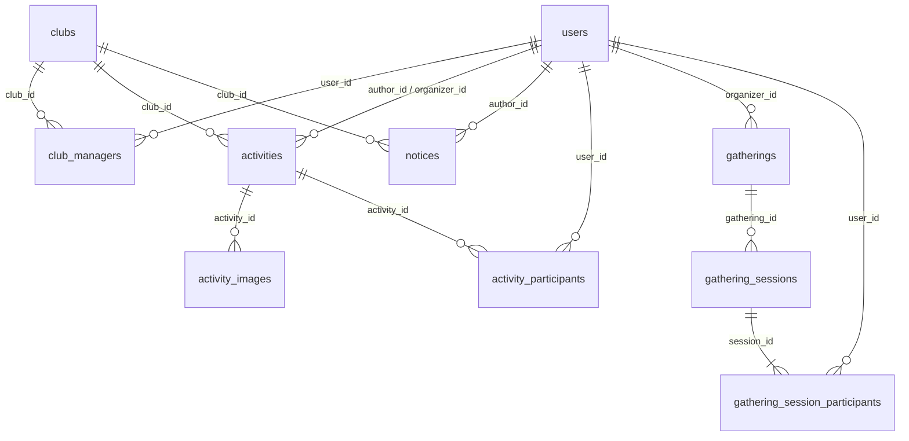

# 데이터 모델과 ERD

실제 DB에는 `users`([V1](../src/main/resources/db/migration/V1__create_users.sql))와 `clubs`([V2](../src/main/resources/db/migration/V2__create_clubs.sql))만 있습니다.
아래 나머지 테이블은 [현재 MVP](domain-model.md#축소-mvp--2026-10-14-확정)를 위한 미구현 설계 초안입니다. 회원 관리·승인제·출결 필드는 [후속 스키마](future-design.md#후속-스키마)에 분리합니다.

- [관계도](#관계도) · [공통 규칙](#공통-규칙)
- 구현됨: [users](#users) · [clubs](#clubs)
- 설계: [관리 권한](#club_managers) · [활동](#activities) · [공지](#notices) · [소모임](#gatherings) · [회차](#gathering_sessions) · [회차 참가](#gathering_session_participants) · [활동 참가](#activity_participants) · [사진](#activity_images)
- [인덱스](#초기-인덱스) · [남은 설계](#구현-전-확정할-사항)

## 관계도

users·clubs 이외의 관계는 구현 예정입니다. 아래 도식은 후속 회원·고정 멤버·출결 관계를 제외한 설계입니다.

## 공통 규칙

- PK는 자동 생성 BIGINT, 필수 FK는 NOT NULL이며 users 등 내부 PK를 참조합니다. 표의 필수 O는 NOT NULL입니다.
- 생성·수정 시각은 TIMESTAMPTZ, 현재 활동일·동아리 모집 날짜는 DATE입니다. 활동 개최 시각의 최종 표현은 미정입니다.
- 역할·상태는 VARCHAR와 CHECK로 허용값을 제한합니다. 문자열 공백 등 입력 검증은 별도로 적용합니다.
- FK에 연쇄 삭제를 설정하지 않습니다. updated_at은 애플리케이션에서 갱신합니다.
- 활동·공지·소모임의 deleted_at은 NULL이면 미삭제이며 일반 조회에 IS NULL 조건을 적용합니다. 삭제 실행 API는 후속입니다.
- D-Day·현재 인원·잔여 정원·모집 표시 상태는 파생 값이며 저장하지 않습니다.

## users

| 컬럼 | 타입 | 필수 | 제약 및 의미 |
| --- | --- | --- | --- |
| id | BIGINT | O | PK |
| intra_id | BIGINT | O | UNIQUE, 42 계정 연결 기준 |
| intra_login | VARCHAR(100) | O | Intra 로그인명, 계정 연결 기준으로 사용하지 않음 |
| display_name | VARCHAR(100) | O | 표시 이름 |
| role | VARCHAR(20) | O | USER / ADMIN, 기본값 USER |
| created_at | TIMESTAMPTZ | O | 계정 생성 시각 |
| updated_at | TIMESTAMPTZ | O | 수정 시각 |

- MVP는 현재 V1·User 엔티티와 동일한 스키마를 사용합니다. account_status·BLACKHOLED 상태·식별 정보의 조건부 NULL 제약은 추가하지 않습니다.

계정 생성·권한 부여 정책은 [도메인 문서](domain-model.md#사용자-역할과-동아리-관리-권한)를 참조합니다.

## clubs

| 컬럼 | 타입 | 필수 | 제약 및 의미 |
| --- | --- | --- | --- |
| id | BIGINT | O | PK |
| name | VARCHAR(100) | O | 동아리 이름, 현재 UNIQUE 없음 |
| summary | VARCHAR(200) | O | 목록용 짧은 소개 |
| description | TEXT | O | 상세 소개 |
| operation_status | VARCHAR(20) | O | ACTIVE / ARCHIVED |
| recruitment_planned | BOOLEAN | O | 모집 계획 여부, 기본값 false |
| recruitment_start_date | DATE | 조건부 | 모집 계획이 있으면 필수 |
| recruitment_end_date | DATE | X | 없으면 시작일부터 상시 모집 |
| recruitment_closed_early | BOOLEAN | O | 수동·운영 상태 변경에 따른 마감, 기본값 false |
| application_method | TEXT | 조건부 | 모집 계획이 있으면 지원 방법 필수 |
| application_url | VARCHAR(2048) | X | 외부 지원 링크 |
| created_at | TIMESTAMPTZ | O | 생성 시각 |
| updated_at | TIMESTAMPTZ | O | 수정 시각 |

### 모집 정보의 데이터 제약

- 모집 계획이 있으면 시작일과 지원 방법이 필수입니다.
- 종료일이 있으면 시작일도 존재하고 종료일 >= 시작일이어야 합니다.
- recruitment_closed_early가 true이면 recruitment_planned도 true여야 합니다.
- [모집 계획 취소](future-design.md#모집-계획-취소--확정) 시 recruitment_planned와 recruitment_closed_early는 false, recruitment_start_date·recruitment_end_date·application_method·application_url은 NULL로 저장합니다. 이 초기화는 후속 모집 쓰기 유스케이스에서 처리하며, 현재 DB CHECK는 이 NULL 조합 전체를 강제하지 않습니다.

상태 변경과 아카이브·재모집 동작은 [도메인 정책](future-design.md#게시-및-아카이브-정책--확정)을 따릅니다.
활동도·표시용 모집 상태는 파생 값이며 저장 컬럼을 두지 않습니다. 활동도의 날짜 경계와 수정 반영은 [집계 정책](future-design.md#활동도-계산)을 따릅니다. 별도 아카이브 테이블이나 archived_at 컬럼은 없습니다.

## club_managers

| 컬럼 | 타입 | 필수 | 제약 및 의미 |
| --- | --- | --- | --- |
| id | BIGINT | O | PK |
| user_id | BIGINT | O | FK → users.id |
| club_id | BIGINT | O | FK → clubs.id |
| created_at | TIMESTAMPTZ | O | 권한 부여 시각 |

- UNIQUE(user_id, club_id)로 관리 권한 중복을 방지합니다.
- 동아리별 관리자는 0명 이상이며, 사용자도 여러 동아리를 관리할 수 있습니다.
- 별도 관리자 등급이나 동아리 회원 관계를 표현하지 않습니다. 회장도 이 관리 관계로 표현하며 별도 회장 테이블·역할 컬럼을 두지 않습니다. 사용자 역할과 관리 권한의 조합은 [도메인 권한 정책](domain-model.md#사용자-역할과-동아리-관리-권한)을 따릅니다.

## activities

| 컬럼 | 타입 | 필수 | 제약 및 의미 |
| --- | --- | --- | --- |
| id | BIGINT | O | PK |
| club_id | BIGINT | O | FK → clubs.id |
| author_id | BIGINT | O | FK → users.id, 최초 작성자 |
| organizer_id | BIGINT | O | FK → users.id, 지정된 활동 주최자 |
| title | VARCHAR(200) | O | 제목 |
| content | TEXT | O | 활동 내용 |
| activity_date | DATE | O | 실제 활동일, 활동도 계산 기준 |
| capacity | INTEGER | O | 활동 참가 총정원, 주최자 포함, 1 이상; 설계 초안 |
| recruitment_closes_at | TIMESTAMPTZ | O | 활동 참가 모집 종료 시각; 종료일의 시각 경계는 후속 확정 |
| created_at | TIMESTAMPTZ | O | 등록 시각 |
| updated_at | TIMESTAMPTZ | O | 수정 시각 |
| deleted_at | TIMESTAMPTZ | X | NULL이면 미삭제, 값이 있으면 논리 삭제 시각 |

작성자와 주최자는 별도의 필수 사용자 관계입니다. 생성 시 주최자의 CONFIRMED 참가 관계도 같은 트랜잭션에서 저장합니다.
권한과 자동 참가 정책은 [활동 주최자](domain-model.md#동아리-활동-주최자--확정)를 따릅니다. 날짜·정원·마감 필드의 상세 제약은 구현 전 확정합니다.

## notices

| 컬럼 | 타입 | 필수 | 제약 및 의미 |
| --- | --- | --- | --- |
| id | BIGINT | O | PK |
| club_id | BIGINT | O | FK → clubs.id |
| author_id | BIGINT | O | FK → users.id, 최초 작성자 |
| title | VARCHAR(200) | O | 제목 |
| content | TEXT | O | 공지 내용 |
| created_at | TIMESTAMPTZ | O | 등록 시각 |
| updated_at | TIMESTAMPTZ | O | 수정 시각 |
| deleted_at | TIMESTAMPTZ | X | NULL이면 미삭제, 값이 있으면 논리 삭제 시각 |

작성 권한은 현재 club_managers 관계로 검사합니다. deleted_at은 최초 마이그레이션에 포함할 예정이며 삭제 실행은 후속입니다.

## gatherings

| 컬럼 | 타입 | 필수 | 의미 |
| --- | --- | --- | --- |
| id | BIGINT | O | PK |
| organizer_id | BIGINT | O | FK → users.id, 생성자·주최자 |
| title | VARCHAR(200) | O | 소모임 모집 글 제목, 설계 초안 |
| content | TEXT | O | 소모임 모집 글 내용, 설계 초안 |
| capacity | INTEGER | O | 새 회차의 기본 정원, 주최자 포함, 1 이상 |
| deleted_at | TIMESTAMPTZ | X | NULL이면 미삭제, 일반 조회 제외용; 삭제 API는 후속 |

참가 방식은 FIRST_COME로 고정합니다. 진행 유형·참여 단위·승인제 컬럼은 [확장 필드](future-design.md#소모임-확장-필드)에서 관리합니다. 기본 이미지는 공통 표시 자산으로 별도 업로드 컬럼을 필수로 요구하지 않습니다.

## gathering_sessions

| 컬럼 | 타입 | 필수 | 의미 |
| --- | --- | --- | --- |
| id | BIGINT | O | PK |
| gathering_id | BIGINT | O | FK → gatherings.id |
| starts_at / ends_at | TIMESTAMPTZ | O | 실제 회차 시작·종료, 종료 > 시작 |
| location | VARCHAR(255) | O | 개최 장소 (길이 초안) |
| capacity | INTEGER | O | 주최자 포함 회차 정원, 1 이상 |
| recruitment_opens_at | TIMESTAMPTZ | 조건부 | 회차 모집 공개 시각 |
| recruitment_closes_at | TIMESTAMPTZ | 조건부 | 회차 모집 마감 시각 |
| cancelled_at | TIMESTAMPTZ | X | 회차 취소 시각 |

- 공개 <= 시작 - 2시간, 공개 < 마감 < 시작을 검증합니다. 신규 공개 시 과거 시각 지정은 거부합니다.
- 조기 마감·실제 공개 시각 감사 정보는 API 상세 설계와 함께 컬럼을 보완합니다.
- 일회성도 회차 하나를 생성하는 기존 구조입니다. 회차 생성 API·모집 글과의 원자적 저장 범위는 구현 전 확정합니다.
- 반복 회차·고정 멤버 명단 반영은 후속 설계입니다.

## gathering_session_participants

| 컬럼 | 타입 | 필수 | 의미 |
| --- | --- | --- | --- |
| id | BIGINT | O | PK |
| session_id | BIGINT | O | FK → gathering_sessions.id |
| user_id | BIGINT | O | FK → users.id |
| status | VARCHAR(20) | O | CONFIRMED / CANCELLED |
| created_at / updated_at | TIMESTAMPTZ | O | 최초 생성·마지막 수정 |

UNIQUE(session_id, user_id)로 중복 참가를 방지합니다. gathering_id는 session_id로 알 수 있으므로 중복 저장하지 않습니다. 취소·재참가는 기존 행의 상태를 변경합니다.

## activity_participants

| 컬럼 | 타입 | 필수 | 제약 및 의미 |
| --- | --- | --- | --- |
| id | BIGINT | O | PK |
| activity_id | BIGINT | O | FK → activities.id |
| user_id | BIGINT | O | FK → users.id |
| status | VARCHAR(20) | O | CONFIRMED / CANCELLED, 본인 선착순 참가·취소 |
| created_at | TIMESTAMPTZ | O | 참가자 등록 시각 |
| updated_at | TIMESTAMPTZ | O | 마지막 수정 시각 |

UNIQUE(activity_id, user_id)로 중복 참가를 방지합니다. 취소·재참가는 기존 행의 상태를 변경합니다. 출결 필드는 [후속 스키마](future-design.md#출결-확장-필드)를 참고합니다.

## activity_images

| 컬럼 | 타입 | 필수 | 의미 |
| --- | --- | --- | --- |
| id | BIGINT | O | PK |
| activity_id | BIGINT | O | FK → activities.id |
| storage_key | TEXT | O | 파일 저장 위치 식별자, 저장 방식 확정 후 타입·제약 보완 |
| sort_order | INTEGER | O | 사진 표시 순서, 0 이상 |
| created_at | TIMESTAMPTZ | O | 사진 연결 시각 |

사진 첨부는 축소 MVP에 포함합니다. 파일 개수·크기·형식, 업로드 경로와 실패/미사용 파일 정리는 구현 전에 확정합니다. 이 정의는 미구현 설계 초안입니다.

## 초기 인덱스

| 테이블 | 키 | 목적 |
| --- | --- | --- |
| users | UNIQUE(intra_id) | 42 계정 조회 및 중복 방지 |
| club_managers | UNIQUE(user_id, club_id) | 권한 확인, 사용자별 관리 동아리 조회 |
| club_managers | INDEX(club_id) | 동아리별 관리자 조회 |
| activities | INDEX(club_id, activity_date) | 동아리별 활동 조회와 활동도 집계 |
| notices | INDEX(club_id, created_at) | 동아리별 공지 조회 |
| gatherings | INDEX(organizer_id) | 주최한 소모임 조회 |
| gathering_sessions | INDEX(gathering_id, starts_at) | 모임별 일정 조회 |
| gathering_session_participants | UNIQUE(session_id, user_id) | 회차 참여 중복 방지 |
| gathering_session_participants | INDEX(user_id) | 내 회차 참여 조회 |
| activity_participants | UNIQUE(activity_id, user_id) | 참가자 중복 방지 및 활동별 명단 조회 |
| activity_participants | INDEX(user_id) | 사용자별 활동 참여 조회 |

PK에는 기본 인덱스가 존재합니다. 추가 인덱스는 API 조회 조건과 실행 계획을 확인하며 결정합니다.

## 구현 전 확정할 사항

- 활동 개최 시각·모집 마감의 타입과 제약, 사진 저장 식별자·제약: [업무 결정](domain-model.md#남은-결정-사항) 이후 반영
- 동시 정원 보장을 위한 잠금 또는 원자적 갱신 전략; 현재 인원 파생값만 조회한 뒤 저장하는 방식은 정원을 보장하지 못함
- 소모임의 모집 글·첫 회차 생성 단위, 추가 생성·수정 시각 컬럼
- API 조회 조건에 맞춘 추가 인덱스와 참가 상태 CHECK 제약

회원·반복·고정 멤버·출결 스키마는 범위 합의 없이 최초 MVP 마이그레이션에 포함하지 않습니다.
